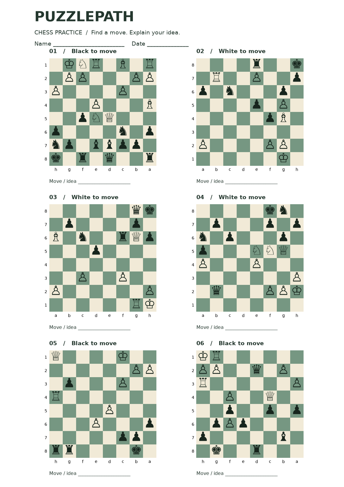

# PuzzlePath

[](https://github.com/BoingCoder/PuzzlePath/actions/workflows/ci.yml)
[](LICENSE)

**Chess puzzle difficulty, starting from the board.**

Can a position tell us how hard a chess puzzle will be, before anyone attempts
it? PuzzlePath tests that question using public Lichess puzzles, 50 board-derived
features, simple baselines, and gradient boosting. It also turns a puzzle
collection into printable practice sheets with separate PDF and PGN answers.

The short answer: these features help a little, but leave much unexplained.
That result matters when deciding whether to trust a model with practice levels.
This is a research prototype for unrated exercises, not a chess engine or a
validated tutoring system. It runs on a CPU without an API key or Stockfish.


## Results you can inspect

The model was developed on a fixed 20,000-puzzle sample, with separate train,
validation, calibration, and test components. It was then frozen and checked
on another export window. One overlapping puzzle was excluded, leaving 3,999.

| Separate-window confirmation | MAE ↓ | RMSE ↓ | R² ↑ |
| --- | ---: | ---: | ---: |
| Training-median baseline | 316.4 | 392.9 | -0.007 |
| Frozen gradient boosting | **296.8** | **370.2** | **0.106** |

That is a **6.2% reduction in MAE**, not high-precision rating prediction. The
95% component-bootstrap interval for model MAE is 289.9–303.4 points. A nominal
90% calibrated interval has a radius of about **614 points**; it covers 90.9%
of this confirmation sample. Coverage for individual rating bands or unrelated
positions is not guaranteed.

The first representation, its modest result, the tactical-feature revision,
and the reused development test are all retained in the
[experiment record](docs/experiments.md). Read the
[development report](artifacts/benchmark/report.md),
[separate-window report](artifacts/confirmation/report.md), and
[model card](docs/model-card.md) for the boundaries behind these numbers.

## Try it

Use Python 3.12 and [uv](https://docs.astral.sh/uv/). From a clone of this repository:

```bash
uv sync --frozen --extra dev
uv run puzzlepath audit

# This is the position the solver sees, AFTER the opponent's setup move.
uv run puzzlepath predict \
  --fen 'q5nr/1ppknQpp/3p4/1P2p3/4P3/B1PP1b2/B5PP/5K2 w - - 1 18'
```

The published example returns an estimated puzzle rating of 1624 and an interval
of 1010–2238. This is a puzzle-rating estimate, not a player rating or a solve
probability. The bundled `model.joblib` is pickle-based: use the artifact from a
trusted checkout, or train your own. The lockfile matches its scikit-learn version.

Create a practice set:

```bash
uv run puzzlepath practice --target 1400 --count 6
uv run puzzlepath practice --target 1600 --theme fork --output outputs/forks
```

Each output directory contains `practice.pdf`, `answers.pgn`, `preview.png`, and
`session.json`. The PDF puts exercises first and the answer key on later pages.
Boards face the side to move, and the full legal solution is retained in the PGN.
The target is a **puzzle rating**, not an assumed student rating.

[Open the example worksheet](examples/practice-1400/practice.pdf) ·
[Inspect its PGN answers](examples/practice-1400/answers.pgn)



For already-rated puzzles, practice selection defaults to observed Lichess
ratings. Replacing those with weaker estimates would not help. Use
`--rank-by predicted` only to explore model-based ordering. The `predict` command
is the route for an unrated, solver-ready FEN.

## Reproduce the experiment

The data snapshots, manifests, fitted model, predictions, and plots are committed.
Reproduction needs no data download or network service after dependencies are
installed.

```bash
uv run puzzlepath train --output outputs/reproduction
uv run puzzlepath audit --run outputs/reproduction
uv run puzzlepath evaluate \
  --run outputs/reproduction --output outputs/confirmation
```

The training command compares a median baseline, material-only ridge, full-feature
ridge, and two bounded boosting configurations. Selection uses validation MAE.
Calibration supplies an uncertainty radius; test data does not fit or calibrate
the model. Reports include rating slices, bootstrap uncertainty, and validation
permutation importance. Output directories must be empty so a new run cannot
silently replace a previous result.

To acquire a new sample, use a new path:

```bash
uv run puzzlepath fetch --output outputs/new-snapshot.csv
```

The default download samples eligible rows from a bounded prefix, not uniformly
from all Lichess puzzles. The source URL changes; the committed CSV hashes
identify the exact data used here. See [data notes](data/README.md).

## Decisions that affect the result

- **Start at the right position.** Lichess FENs precede the opponent's first move.
  Apply it before extracting features or drawing the board.
- **Keep the answer out.** Ratings, theme tags, solution moves and length,
  popularity, play counts, and source identifiers are excluded from features.
- **Keep related examples together.** Source games and identical solver positions
  form connected components. Those components stay in one partition.
- **Show the uncertainty.** Calibration uses maximum absolute error per component.
  Wide intervals and poor performance at rating extremes remain visible.
- **Preserve unsuccessful assumptions.** The baseline and revised representation
  are both retained. The confirmation sample is a new source window, not a
  claim about future puzzles, other websites, or teaching outcomes.

## Project map

```text
src/puzzlepath/
  data.py        streamed sampling, manifests, and puzzle validation
  features.py    solver-relative board and bounded tactical features
  splits.py      connected game/position groups and deterministic partitions
  model.py       baselines, selection, calibration, and inference
  evaluation.py  frozen-model confirmation with overlap exclusion
  practice.py    diverse exercise selection, printable PDF, and PGN
  report.py      experiment reports and exportable scientific figures
  cli.py         fetch / train / predict / practice / audit / evaluate
```

[Design decisions](docs/design.md) · [Experiment record](docs/experiments.md) ·
[Model card](docs/model-card.md) · [Contributing](CONTRIBUTING.md)

```bash
uv run ruff check src tests
uv run ruff format --check src tests
uv run pytest -q
```

The tests cover setup-move semantics, color mirroring, label isolation, grouped
splits, finite-sample calibration, snapshot checks, train/inference agreement,
external overlap exclusion, and legal worksheet solutions. CI runs offline
against the committed data.

## License and sources

Code: [GPL-3.0-or-later](LICENSE), compatible with the GPL-licensed
[python-chess](https://python-chess.readthedocs.io/). Public puzzle snapshots:
[Lichess open database, CC0](https://database.lichess.org/#puzzles).
Models use [scikit-learn](https://scikit-learn.org/); figures and PDFs use
[Matplotlib](https://matplotlib.org/). This project is independent of Lichess.
