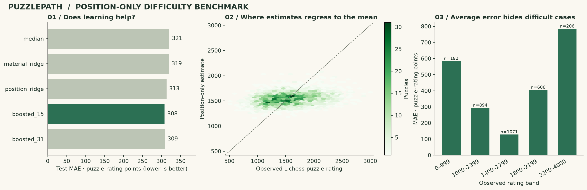
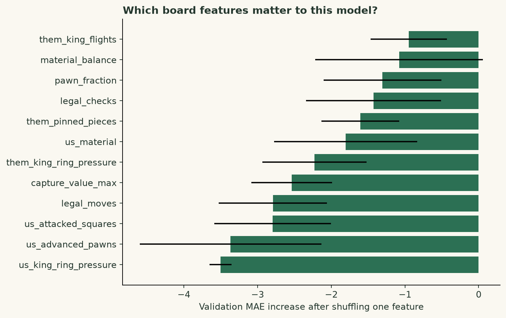

# Benchmark report

Run timestamp (UTC): 2026-10-30T02:59:24.287810+00:00

20,000 public puzzles; 45 position-only features.
Selected **boosted_15** using validation MAE, before test evaluation.

| Model | Validation MAE | Test MAE | Test RMSE | Test R² | Within 200 |
| --- | ---: | ---: | ---: | ---: | ---: |
| median | 324.1 | 320.5 | 397.7 | -0.005 | 36.9% |
| material_ridge | 323.5 | 319.5 | 393.9 | 0.013 | 36.5% |
| position_ridge | 317.5 | 313.2 | 386.5 | 0.050 | 36.7% |
| boosted_15 | 311.5 | 308.2 | 383.3 | 0.066 | 38.1% |
| boosted_31 | 313.3 | 308.9 | 384.2 | 0.061 | 38.5% |

Selected-model test MAE: **308.2** rating points.
95% component-bootstrap interval for MAE: **299.9–316.6**.



## Data boundaries

| Partition | Puzzles | Connected components |
| --- | ---: | ---: |
| train | 12,007 | 12,007 |
| validation | 3,041 | 3,040 |
| calibration | 1,993 | 1,992 |
| test | 2,959 | 2,959 |

Source games and identical solver positions do not cross partitions.
The connected-component split includes transitive links. The fixed sample is a
reservoir over an eligible export prefix; see `data/puzzles.manifest.json`.

## Uncertainty

Nominal component coverage: 90%. Calibration uses
1,992 component maximum absolute residuals.
The resulting radius is **±623** rating points.

Observed test row coverage: **89.6%**;
test component coverage: **89.6%**.

This is marginal coverage under exchangeability assumptions, not a guarantee
for an individual position, a rating band, a different website, or a student.
Wide intervals are an important result: board features leave much unexplained.

## Error by observed rating

| Rating band | Puzzles | MAE | Interval coverage |
| --- | ---: | ---: | ---: |
| 0–999 | 182 | 583.8 | 62.1% |
| 1000–1399 | 894 | 293.3 | 98.4% |
| 1400–1799 | 1071 | 127.7 | 100.0% |
| 1800–2199 | 606 | 404.6 | 91.3% |
| 2200–4000 | 206 | 784.2 | 17.0% |

## Feature inspection



Permutation importance uses validation data (three repeats, at most 1,000 rows).
The validation partition also selects the model. This plot is descriptive;
correlated features share importance, and importance does not establish causation.

## Limitations

- Bounded-prefix sample, filtered on play count and rating deviation.
- No temporal holdout or demonstrated generalization to an unrelated puzzle source.
- Static features do not search the solution or measure human thinking time.
- Intervals are marginal across components, not conditional on rating or learner.
- No measured teaching benefit or individual solve-probability calibration.

## Reproduce

```bash
uv sync --frozen --extra dev
uv run puzzlepath train --data data/puzzles.csv --output outputs/reproduction
uv run puzzlepath audit --data data/puzzles.csv --run outputs/reproduction
```

Data SHA-256: `c8a742ac65c2641abe755d2a0f63806c93686c9accd38100b0886815b6c83795`.
Model SHA-256: `f580b1528cb8287b48b11725a9ece7c3c94d66586965dbaf654ed033cd64732e`.

Timestamps and serialized model bytes may differ on a repeated run; compare
splits, selected configuration, predictions, and metrics using the locked environment.
